# GOV.UK app components

An inventory of the UI components that exist in the GOV.UK app today, on both platforms, including work that so far only exists on feature branches.

Surveyed on 17 November 2026 from:

| Repo | Commit (`main`) | Remote branches checked |
| --- | --- | --- |
| [govuk-mobile-ios-app](https://github.com/govuk-once/govuk-mobile-ios-app) | `1e520fc1` | 30 |
| [govuk-mobile-ios-gov-kit](https://github.com/govuk-once/govuk-mobile-ios-gov-kit) (iOS shared UI package) | `ad8590b` | 8 |
| [govuk-mobile-android-app](https://github.com/govuk-once/govuk-mobile-android-app) | `16621861` | 83 |

Names are the type or function names used in code, so you can search for them. Screenshots are the light-mode reference images from each app's own snapshot tests; `screenshots/index.json` records each image's source file. Some Android design-system images come from the `GOVUKAPP-4072-screenshot-test` branch, because `main` has no screenshot tests for that module yet. Route/navigation wrappers and preview-only functions are left out.

---

## 1. Design system (shared building blocks)

Android keeps these in the `design` module (`design/src/main/.../design/ui/component`). iOS splits them between the GovKit package (`GovKit`, `GovKitUI`) and the app's `SwiftUIViews`, `UIKitViews` and `Views/Common` folders.

### Buttons

| Component | iOS | Android |
| --- | --- | --- |
| Primary button | `GOVUKButton` / `SwiftUIButton` (`.primary`), `PrimaryButtonView` 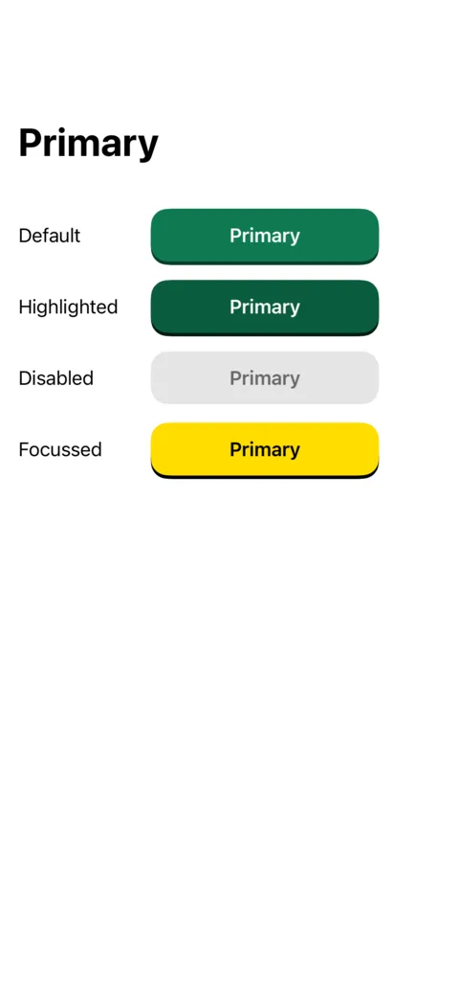 | `PrimaryButton`  |
| Secondary button | `GOVUKButton` (`.secondary`, `.groupedSecondary`) 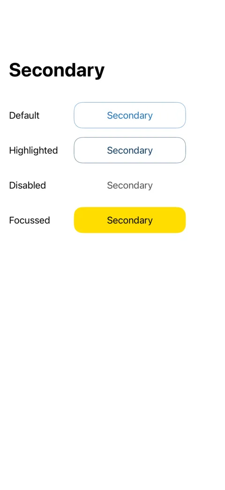 | `SecondaryButton`  |
| Compact button | `GOVUKButton` (`.compact`) 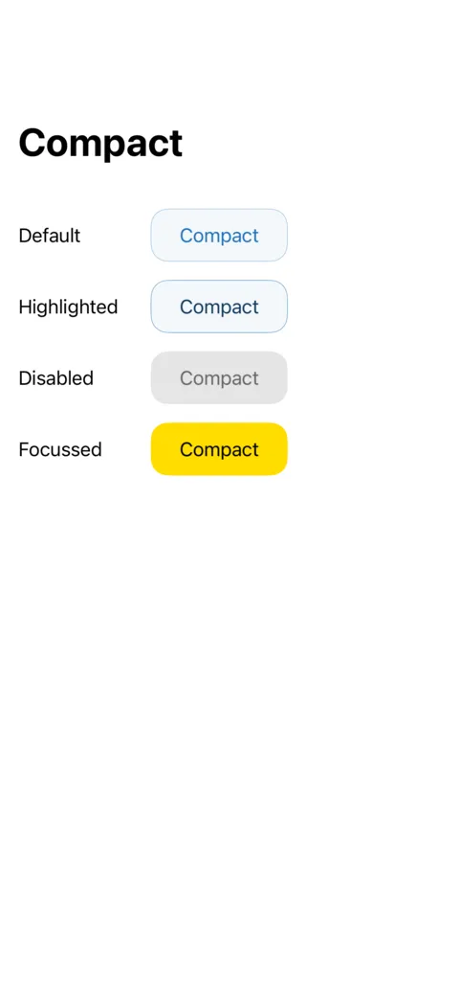 | `CompactButton`, `CompactPrimaryButtonWithIcon`   |
| Destructive button | `GOVUKButton` (`.destructive`) 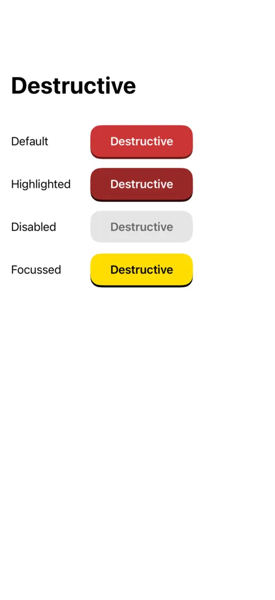 | `DestructiveButton`  |
| Cancel / dismiss | `CancelButton` | `HeaderDismissButton` |
| Header icon button | `CenterAlignedBarButtonItem` | `HeaderIconButton` |
| Overflow (⋯) button | — | `OverflowButton`  |
| Dialog button | — | `DialogButton` |
| Account connection button | — | `AccountConnectionButton`  |
| Connected button | — | `ConnectedButton`  |
| Button stack / group | `ButtonStackView` 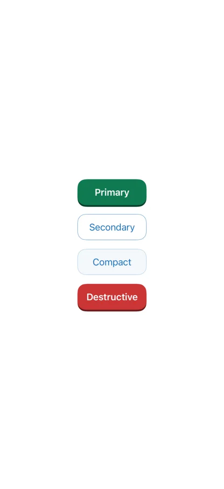 | `DoubleButtonGroup`, `ConnectedButtonGroup` 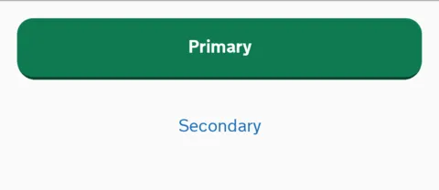  |
| Fixed bottom buttons | — | `FixedPrimaryButton`, `FixedSecondaryButton`, `FixedDoubleButtonGroup` 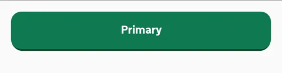 |

### Cards

| Component | iOS | Android |
| --- | --- | --- |
| Outlined card | — | `GovUkOutlinedCard` |
| Non-tappable card | `NonTappableCardView`  | `NonTappableCard`  |
| Centred card with icon | `CentreCardView` (GovKitUI) 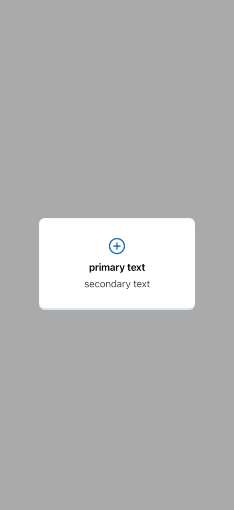 | `CentredCardWithIcon`, `CentredContentWithIcon` 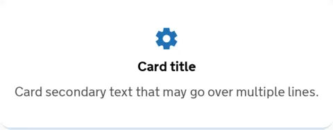 |
| Icon + action card | `IconActionCardView` 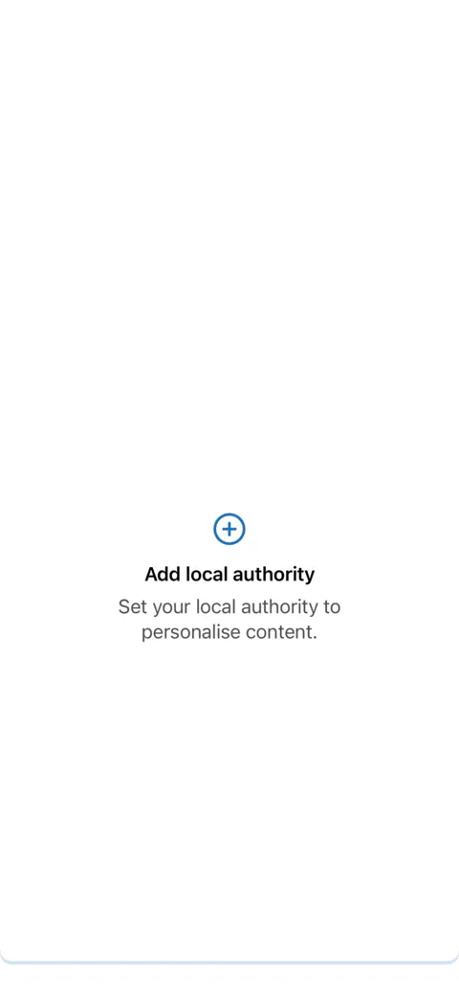 | — |
| Navigation card | — | `NavigationCard` 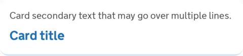 |
| Drill-in card | — | `DrillInCard` 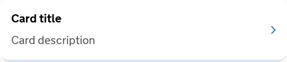 |
| Focusable card | — | `FocusableCard` |
| List card | `ListCardView` | `CardListItem` |
| Search result card | `SearchResultCell` | `SearchResultCard` 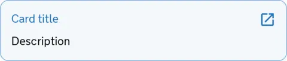 |
| Home banner card | — | `HomeBannerCard`  |
| Quarterly feedback card | `QuarterlySurveyWidgetView` | `QuarterlyFeedbackCard` 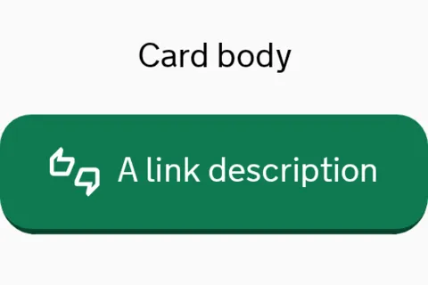 |
| Account connection card | `ServiceAccountLinkCardView` 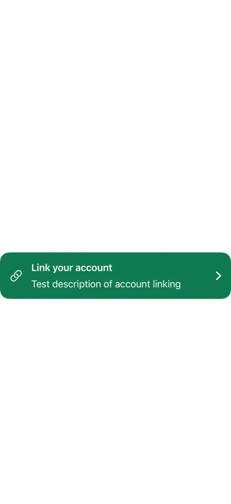 | `AccountConnectionCard`  |
| Loader card | — | `LoaderCard`  |

### Lists

| Component | iOS | Android |
| --- | --- | --- |
| Grouped list | `GroupedList`, `GroupedListSectionView`, `GroupedListRowView`, `GroupedListTableViewCell`, `GroupedListSectionHeaderView` (GovKit) 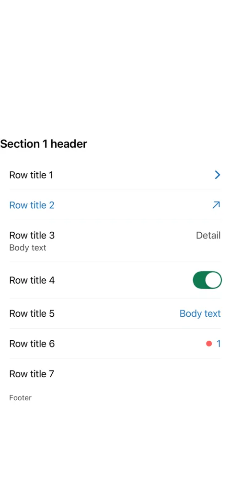 | — |
| Internal link row | (grouped list row) | `InternalLinkListItem` 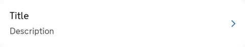 |
| External link row | (grouped list row) | `ExternalLinkListItem`  |
| Toggle row | (grouped list row) | `ToggleListItem` 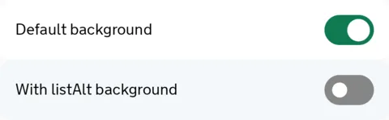 |
| Icon row | — | `IconListItem` |
| Status row | `StatusRowView` 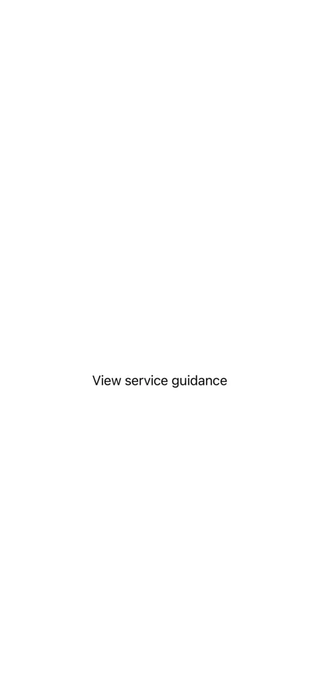 | `StatusListItem` 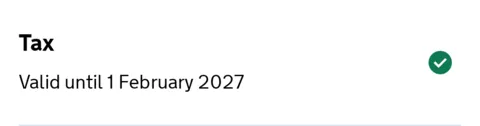 |
| Address row | — | `AddressListItem` 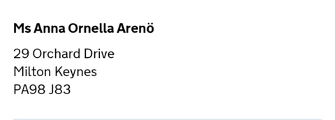 |
| Countdown bar row | — | `CountdownBarListItem` 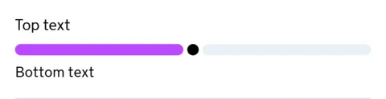 |
| Count row | — | `CountListItem` 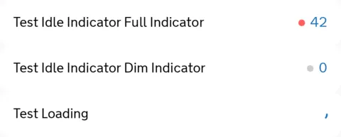 |
| Bulleted list | `BulletView` | — |
| Topic list item | `TopicListItemView`  | — |
| Dividers | `DividerView` | `ListDivider`, `FixedContainerDivider` |

### Headers, titles and text

| Component | iOS | Android |
| --- | --- | --- |
| GOV.UK header | `GovUKHeaderView` (GovKit and app) | — |
| Screen headers | `HeaderView` | `TabHeader`, `FullScreenHeader`, `ChildPageHeader`, `ModalHeader`, `Title` 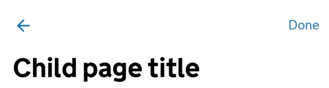 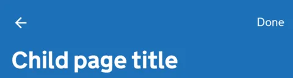 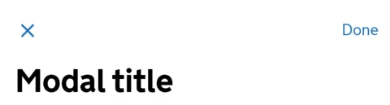 |
| Section heading | `SectionHeaderLabelView` (GovKitUI)  | `SectionHeadingLabel`, `ListHeadingLabel`  |
| Titled section | — | `TitledSection` |
| Text styles | `Font`/`UIFont` extensions (GovKitUI) 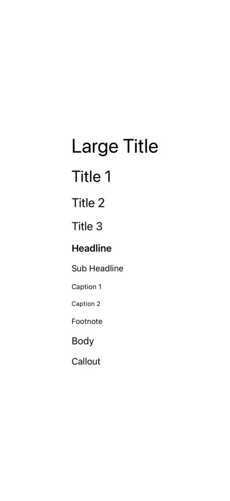 | Labels for each style: `LargeTitle…`, `Title1…`–`Title3…`, `Headline…`, `Body…`, `Callout…`, `Subheadline…`, `Footnote…`, `Caption…` (Bold/SemiBold/Regular, plus `…TrailingLink` variants)   |
| Markdown | `InfoMarkdownView`, `ChatMarkdownTheme`, `NotificationCentreDetailMarkdownTheme` (swift-markdown-ui) | `MarkdownParser` / `MarkdownInlineRendering` |

### Forms and inputs

| Component | iOS | Android |
| --- | --- | --- |
| Search bar | `SearchBarView` | `SearchField`  |
| Radio button | `RadioButtonView` | — |
| Toggle switch | (grouped list row) | `ToggleSwitch`  |
| Growing text input | `DynamicTextEditor` | `ChatInput` |
| Inline action error | `InlineActionErrorView` 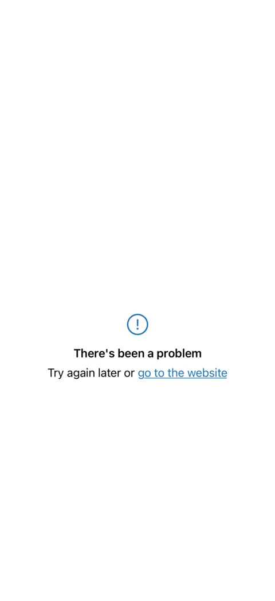 | — |

### Feedback, status and errors

| Component | iOS | Android |
| --- | --- | --- |
| Info alert | — | `InfoAlert` 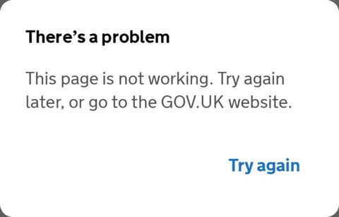 |
| App error view | `AppErrorView` (GovKit), `ErrorView` 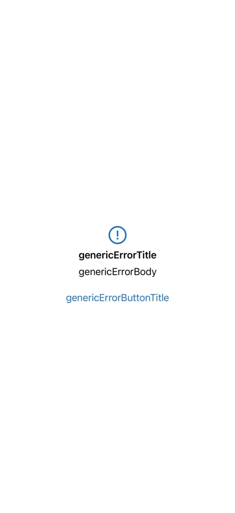 | `Error`, `ErrorPage` 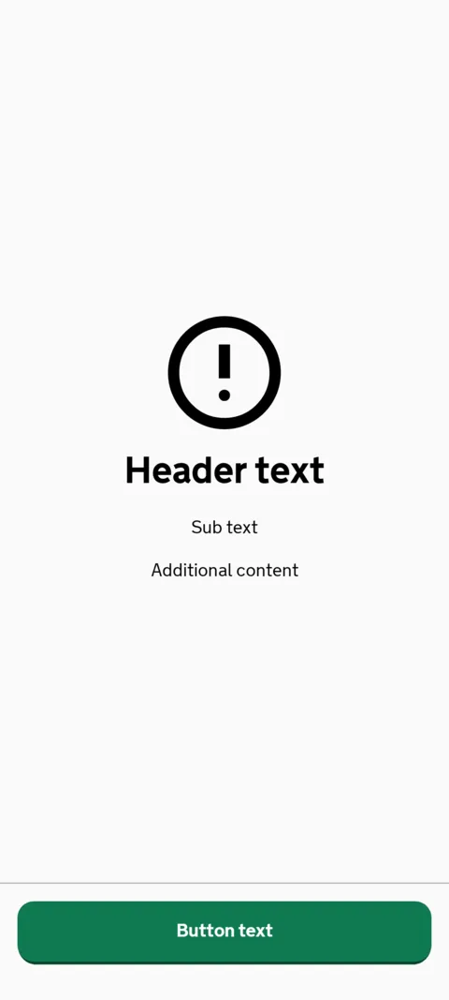 |
| Problem message | — | `ProblemMessage`, `ProblemMessageWithRetry` 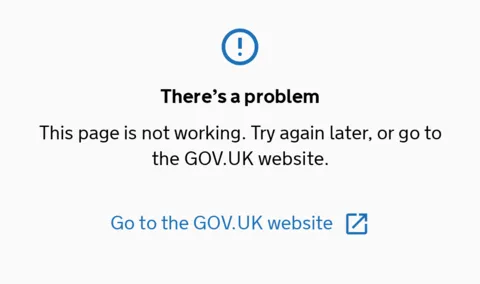 |
| Offline message / screen | — | `OfflineMessage`, `DeviceOfflineScreen` 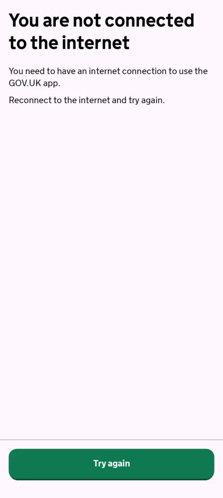 |
| App unavailable | `AppUnavailableContainerView` 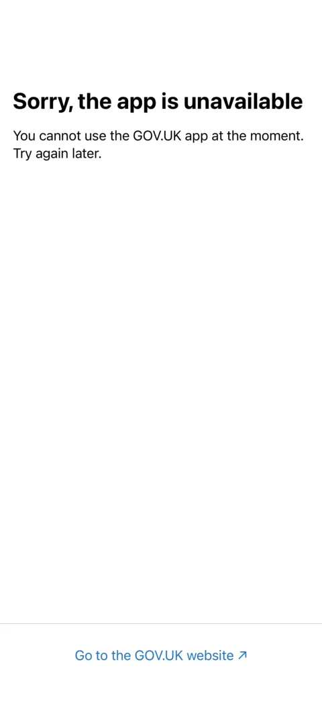 | `AppUnavailableScreen` 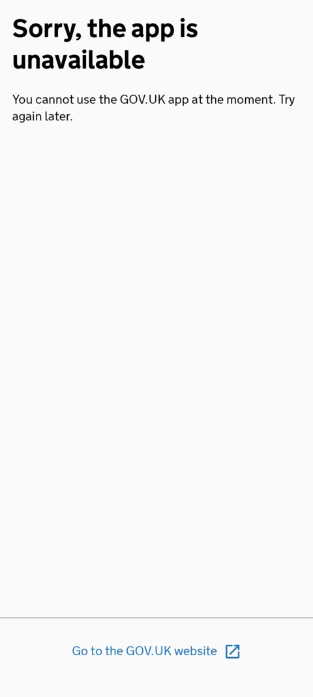 |
| Forced update | `AppForcedUpdateContainerView` 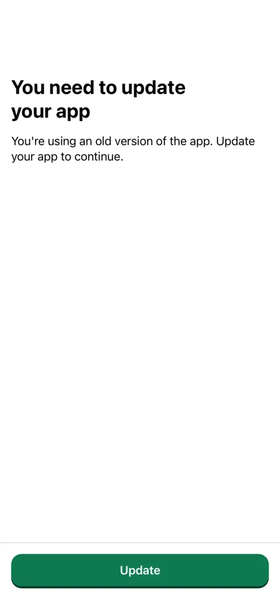 | `ForcedUpdateScreen` 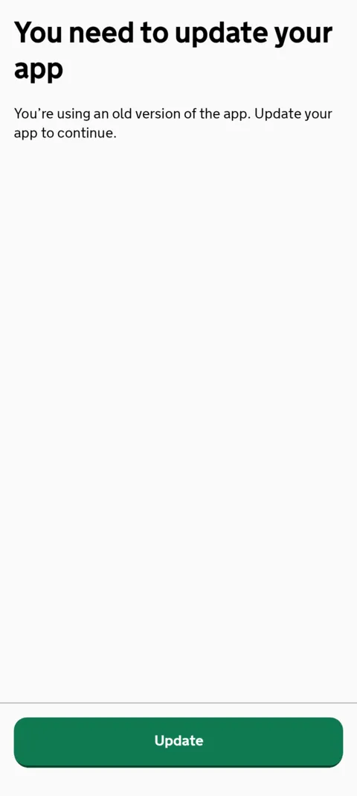 |
| Recommended update | `AppRecommendUpdateContainerView` 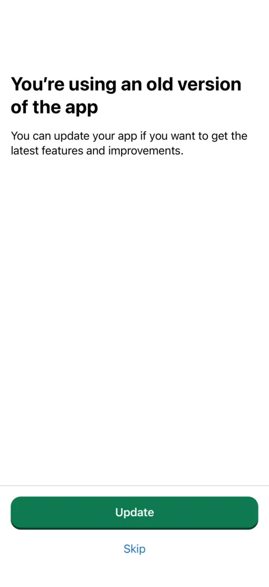 | `RecommendUpdateScreen` 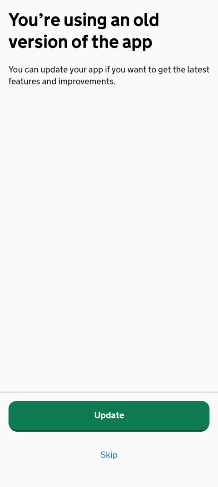 |
| Countdown / expiry bar | `ExpiryProgressView` 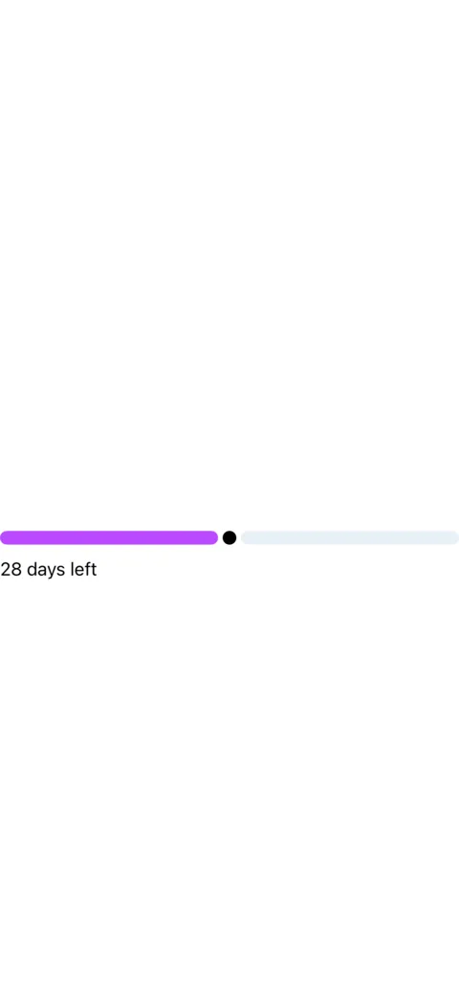 | `CountdownBar` |
| Loading screen | `TravelLoadingView`  | `LoadingScreen` |
| Scroll-for-more indicator | `ScrollBottomIndicatorView` | — |

### Screen templates and layout

| Component | iOS | Android |
| --- | --- | --- |
| Base screen / hosting | `BaseViewController`, `HostingViewController` (GovKit) | `FullScreenWrapper`, `StatusBar` |
| Centre-aligned screen | `InfoView` | `CentreAlignedScreen` |
| Bookend screens | — | `BookendToWebScreen`, `BookendConnectingScreen`, `AccountConnectionSuccessScreen` 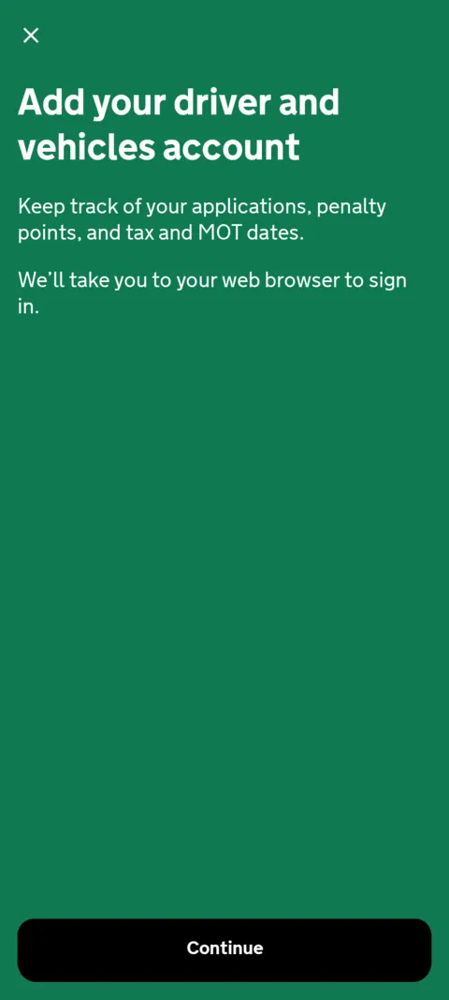 |
| Onboarding slide | (per-feature onboarding views) 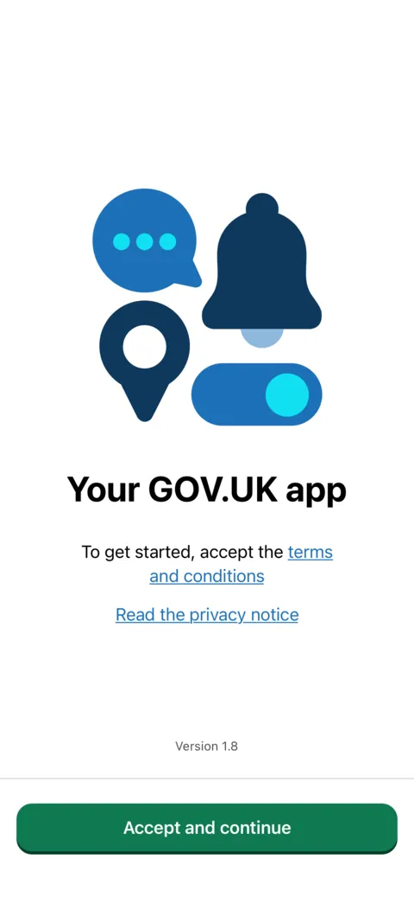 | `OnboardingSlide` 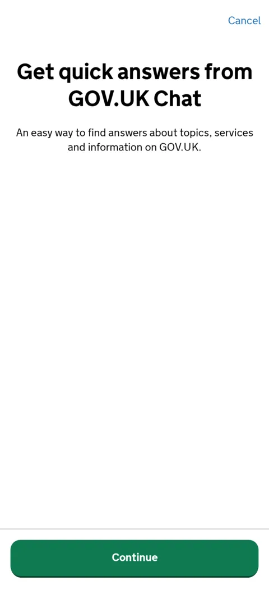 |
| Privacy policy link | `PrivacyView`  | `PrivacyPolicyLink` |
| Terms and conditions | `TermsAndConditionsView` 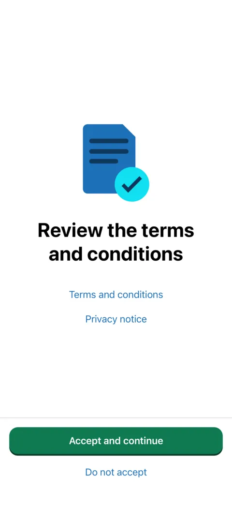 | (terms screen in `app`) 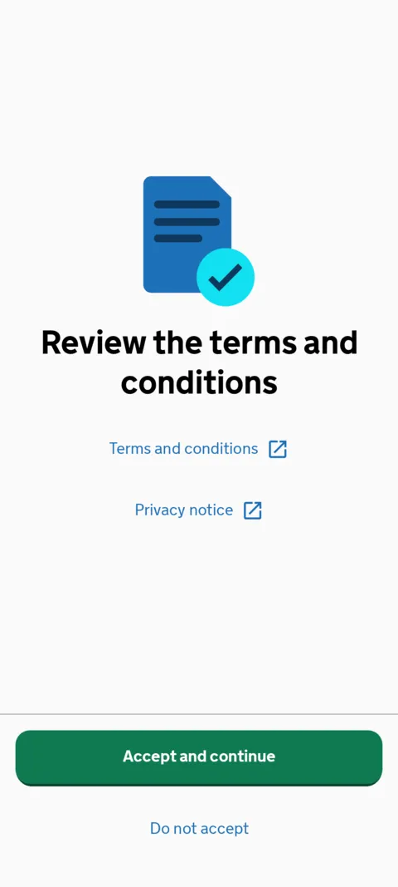 |
| Analytics consent | `AnalyticsConsentContainerView` 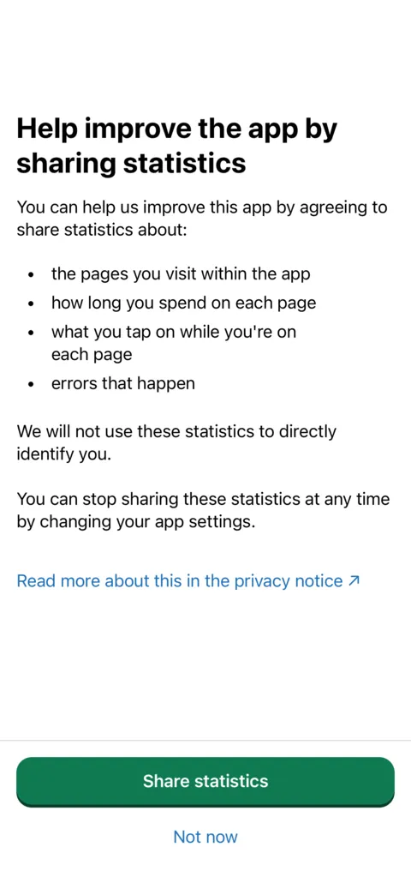 | — |
| Spacers | — | `ExtraSmall…`–`ExtraLarge…` `HorizontalSpacer` / `VerticalSpacer` |
| Specification icons | — | `SpecificationsIcons` 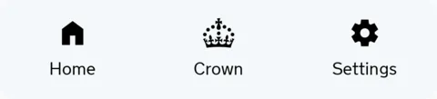 |
| Animation | `AnimationView`, `SwiftUIAnimationView`, `AnimatedAPNGImageView` (Lottie / APNG) | `AnimateIcon` |
| Tab bar | `BaseTabBarController` | — |

### Theme

| | iOS | Android |
| --- | --- | --- |
| Colours | `GOVUKColors` (+ Text, Fills, Strokes) 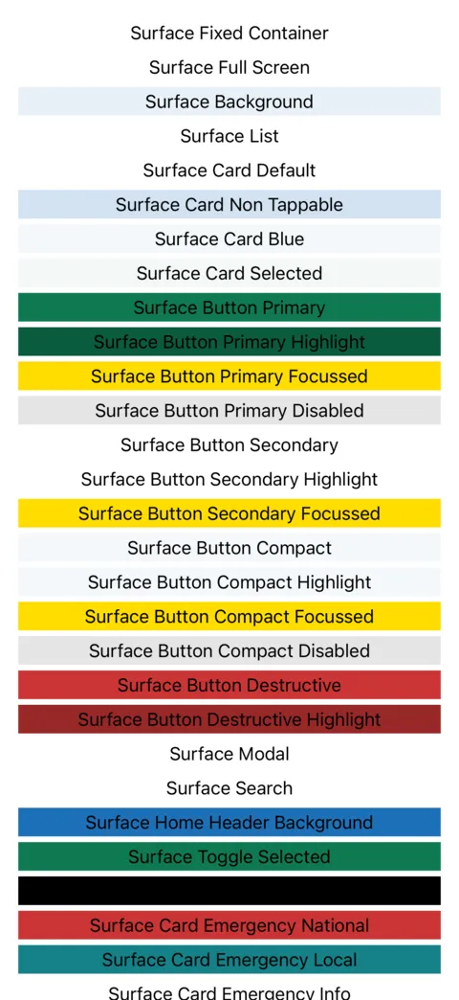 | `Color.kt` |
| Typography | `Font+Extensions`, `UIFont+Extensions`  | `Type.kt` |
| Spacing / sizes | `UIEdgeInsets+Extensions`, `RoundedBorder` | `Spacing.kt`, `Numbers.kt` |
| Theme | — | `GovUkTheme` |

---

## 2. Feature components

### Home and widgets

| Component | iOS | Android |
| --- | --- | --- |
| Homepage widget container | `HomepageWidget`, `HomeContentView` 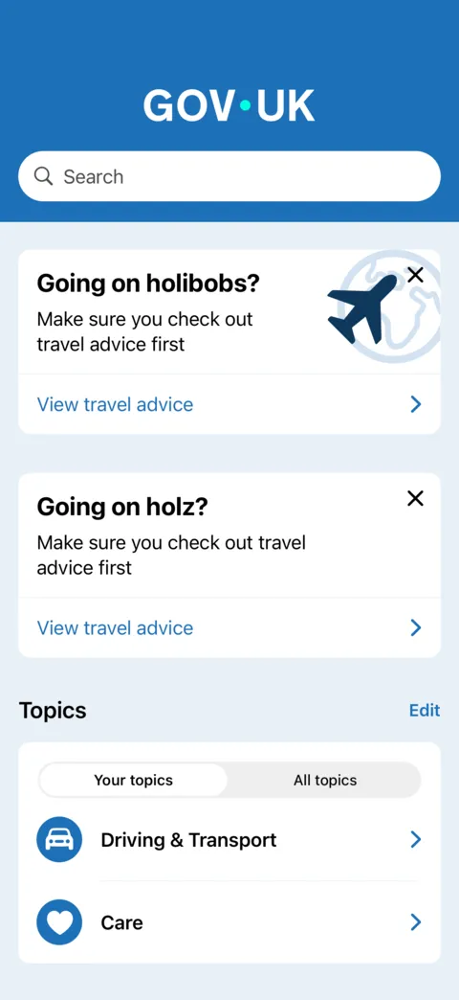 | (home module)  |
| Emergency banner | `EmergencyBannerWidgetView` 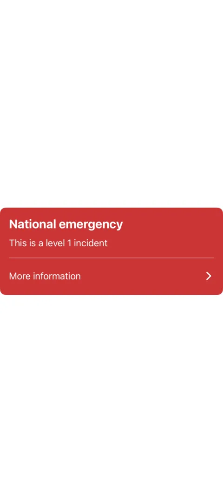 | `EmergencyBanner`  |
| Promo banner | `PromoBannerWidgetView` | `PromoBanner` |
| Quarterly survey banner | `QuarterlySurveyWidgetView` | `QuarterlyFeedbackBanner`  |
| Information panel | `InformationView` | — |
| Recent activity / visited | `RecentActivityWidgetView`  | `VisitedWidget`  |
| Search widget | — | `SearchWidget`  |
| Topics widget | `TopicsWidgetView`, `TopicCard`  | `TopicsWidget`  |
| Travel alerts widget | `TravelAlertsWidgetView` | `TravelAlertsWidget`  |
| Local authority widget | `LocalAuthorityWidget`, `StoredLocalAuthorityWidgetView`, `StoredLocalAuthorityCardView`  | `LocalWidget`  |
| DVLA account widget | `DVLAAccountWidgetView`  | `VehiclesAndLicenceSummaryWidget` |
| Check vehicle widget | — | `CheckVehicleWidget`, `CheckVehicleCard`  |

### Search

| Component | iOS | Android |
| --- | --- | --- |
| Search history | `SearchHistoryCell`  | `PreviousSearches` |
| Suggestions | `SuggestionCell`  | `SearchAutocomplete`  |
| Results | `SearchResultCell`  | `SearchResults` |
| Error | — | `SearchError` |

### Topics

| Component | iOS | Android |
| --- | --- | --- |
| Topic selection card | `TopicSelectionCardView` | `TopicSelectionCard` |
| Topic detail | `TopicDetailView`  | (topic screen) |
| Edit topics | `EditTopicsView`  | (edit topics screen) |
| Topics onboarding | `TopicsOnboardingView`  | — |

### Local services

| Component | iOS | Android |
| --- | --- | --- |
| Explainer | `LocalAuthorityExplainerView`  | (explainer screen)  |
| Postcode entry | `LocalAuthorityPostcodeEntryView`  | (lookup screen)  |
| Address / authority picker | `AmbiguousAddressSelectionView`, `AmbiguousAuthoritySelectionView`  | (address / authority select screens)  |
| Confirmation | `LocalAuthorityConfirmationView`  | (confirmation screen)  |
| Local full-screen header | — | `LocalFullScreenHeader` |

### Chat (GOV.UK Chat)

| Component | iOS | Android |
| --- | --- | --- |
| Chat screen | `ChatView`  | `ChatScreen`  |
| Question bubble | `ChatCellView` | `Question` |
| Answer bubble | `ChatCellView` | `Answer` |
| Sources | — | `Sources` |
| Typing indicator | `ChatEllipsesView` | — |
| Example questions | `ChatExampleQuestionsView`  | `IntroMessages`  |
| Feedback | `ChatFeedbackView`  | — |
| Action menu | `ChatActionView`, `ChatMenuView`  | `ActionMenu` |
| Input | `DynamicTextEditor` | `ChatInput` |
| Onboarding | — | `OnboardingPage`  |
| Errors | — | `ChatErrorPageWithRetry`, `ChatErrorPageNoRetry` |

### DVLA (driving licence and vehicles)

| Component | iOS | Android |
| --- | --- | --- |
| Account summary | `DVLAAccountSummaryView`  | `LicenceSummaryCard`, `LicenceSummaryHeader`, `SummaryCardHeader`  |
| Driving licence | `DrivingLicenceView`, `DrivingLicenceSummaryView`, `DrivingLicenceNoticeView`  | `LicenceNotAvailableCard`  |
| Driving record | `DrivingRecordView` | `DrivingRecordSection`  |
| Licence categories | `LicenceCategoriesSectionView`, `LicenceCategoryDetailView`  | `DrivingCategoriesSection`, `CategoryListItem`  |
| Vehicles list / summary | `VehiclesView`, `VehicleSummaryView`  | `VehicleSummaryCard`, `VehicleSummaryHeader`  |
| Vehicle detail | `VehicleDetailView`, `VehicleSpecView`  | `VehicleDetailsContent`, `VehicleDetailsHeader`  |
| Vehicle check | `VehicleCheckSectionView`, `VehicleCheckResultView`  | `CheckVehicleSheet`, `CheckVehicleDetailsHeader`  |
| Add vehicle | — | `AddVehicleListItem`  |
| Registration number | `RegistrationNumberField`, `RegistrationNumberFormContent`, `RegistrationNumberFormModal`  | `RegistrationPlate`  |
| Status label / row | `StateLabel`, `StateLabelContent`, `StatusRowView`  | `StatusUiItem`, `InfoStatusItem`, `LinkStatusItem`, `StatusButton`   |
| Validity status (tax / MOT) | `ValidityStatusView`, `TaxValidityStatusView`   | — |
| Account linking | `DVLAAuthenticationView` | `DvlaLinkIntroScreen`, `DvlaLinkCard`, `DvlaLinkHeader` |
| Error card | — | `SummaryErrorCard`  |
| Overflow menu | — | `OverflowMenu` |
| Caption | — | `Caption` |

### Service accounts

| Component | iOS | Android |
| --- | --- | --- |
| Consent | `ServiceAccountConsentView`  | — |
| Linking / unlinking | `ServiceAccountLinkingView`, `ServiceAccountUnlinkingView`  | (bookend screens)  |
| Link success | `ServiceAccountLinkSuccessView`  | `AccountConnectionSuccessScreen`  |
| Link card | `ServiceAccountLinkCardView`  | `AccountConnectionCard`  |

### Travel alerts

| Component | iOS | Android |
| --- | --- | --- |
| Country list | `CountryListView`  | `CountryListScreen`  |
| Edit countries | `EditCountriesView` | `EditCountriesScreen`  |
| Country options sheet | `CountryOptionsBottomSheet`  | `CountryOptionsBottomSheet`  |
| Notifications rationale | `NotificationsRationaleView`  | `NotificationsRationaleScreen`  |
| Notification preference sheet | — | `NotificationsPreferenceBottomSheet`  |

### Notifications and messages

| Component | iOS | Android |
| --- | --- | --- |
| Notification centre / messages list | `NotificationCentreView`  | (messages screen)  |
| Message detail | `NotificationCentreDetailView`  | (message detail screen), `Footer`  |
| Errors | `NotificationCentreErrorViews`  | `MessagesScreenError`, `MessagesScreenNoInternet` |
| Notifications onboarding | `NotificationsOnboardingView`  | `NotificationsScreen`  |
| Notifications settings alert | — | `NotificationsSettingsAlert` |

### Settings, account and sign-in

| Component | iOS | Android |
| --- | --- | --- |
| Settings | `SettingsView`  | (settings screen)  |
| Your accounts | `YourAccountsView`  | (your accounts screen)  |
| Remove / unlink account error | `UnlinkAccountsErrorView`  | `RemoveAccountErrorScreen` |
| Sign out confirmation | `SignOutConfirmationView`  | (sign out screen)  |
| Biometrics | `FaceIdSettingsView`, `TouchIdSettingsView`, `LocalAuthenticationOnboardingView`  | (biometric screens)  |
| Subject access request | `SARExplainerView`, `SARResultView`  | — |
| Open source licences | — | `OpenSourceLicensesScreen` |
| Splash | — | `SplashScreen` |

---

## 3. Components that only exist on branches

None of these are on `main` yet. Branch dates are the date of the last commit.

### iOS (`govuk-mobile-ios-app`)

| Branch | Last commit | Components |
| --- | --- | --- |
| `feature/GOVUKAPP-4351-submit-button-focus-state` | 2026-11-17 | `LoadingButton`, `LoadingUIButton` |
| `feature/govukapp-4147-build-child-categories-page` | 2026-11-16 | `LicenceCategoriesListView`, `EntitlementMajorSectionView`, `EntitlementGroupSubSectionView`, `EntitlementRowView`, `EntitlementRowContentView`, `FurtherInformationSectionView`, `TextStyleViews`, `RowHighlightButtonStyle`  |
| `feature/dwp-benefits` | 2026-11-11 | `DWPWidgetView`  |
| `MGC-81-mailbox-client-v0-linkedapp` | 2026-11-09 | `MailboxListView`, `MailboxDetailView`, `MailboxMessageRow` |
| `feature/dwp-feature-switch` | 2026-11-05 | `BenefitsWidgetView` |
| `MGC-81-mailbox-client-v1-linkedapp` | 2026-11-04 | `MailboxListView`, `MailboxDetailView`, `MailboxMessageRow` |
| `feature/registration-component` | 2026-10-09 | `VehiclePlateOverlayView` |
| `feat/NOT-478_TravelAlertsConsentNotificationDisabled` | 2026-09-25 | `TravelAlertPermissionLoadingView`, country details sheet |
| `MGC-81-mailbox-client-v0` | 2026-07-24 | `MailboxListView`, `MailboxDetailView`, `MailboxMessageRow`, `MessageDetailView`, `MessageRowView`, `EmptyMailboxView`, `PaymentConfirmationView` |
| `MGC-81-mailbox-client-v0-mockapp` | 2026-07-23 | `MailboxListView`, `MailboxDetailView`, `MailboxMessageRow`, `PaymentConfirmationView` |
| `feature/mot-states-view-update` | 2026-07-21 | `MOTValidityStatusView` |
| `feature/waste-home` | 2026-03-27 | `LocalWasteWidgetView`, `UnsetLocalWasteWidgetView`, `LocalWastePostcodeEntryView`, `LocalWasteAddressSelectionView`, `LocalWasteAddressPillView`, `LocalWasteScheduleView`, `LocalWasteScheduleItemView`, `ForEachWithSeparator`   |

### iOS GovKit (`govuk-mobile-ios-gov-kit`)

| Branch | Last commit | Components |
| --- | --- | --- |
| `feature/transport-font` | 2026-09-07 | `GOVUKTransportFontProvider` (Transport typeface) |
| `feature/add-topAlignedButton` | 2026-03-10 | `TopAlignedBarButton` |
| `revert-19-feature/fix-toolbar-padding` | 2026-03-10 | `TopAlignedBarButtonItem`, `AdaptiveStack` |

### Android (`govuk-mobile-android-app`)

| Branch | Last commit | Components |
| --- | --- | --- |
| `GOVUKAPP-4275_dwp-payments-and-personal-apis` | 2026-11-17 | `DwpLinkCard`, `DwpLinkHeader` |
| `feature/main_into_feature_conflicts_fixed` | 2026-11-17 | `DwpLinkCard`, `DwpLinkHeader` |
| `feature/GOVUKAPP-4259-Feature-Flag-V2-Entry-Point` | 2026-11-13 | `chatv2` `ChatScreen` (chat v2 entry point) |
| `feature/dwp-benefits` | 2026-11-11 | `DwpLinkCard`, `DwpLinkHeader` |
| `GOVUKAPP-4021-ephemeral-browsing-fix` | 2026-10-29 | `SecureWebViewLoginActivity` (sign-in web view) |
| `GOVUKAPP-3471_ui_for_sar_requests` | 2026-05-11 | `SubjectAccessRequestScreen`, `SubjectAccessRequestDisplayScreen` |
| `spike/tour-carousel` | 2026-04-09 | `TourCarousel`, `TourPage`, `ChatTour` |
| `spike/tour-spotlight` | 2026-04-09 | `TourOverlay`, `TourTarget`, `TourTooltip`, `ChatTour` |
| `spike/tour-spotlight-library` | 2026-04-09 | `TourOverlay`, `TourTarget`, `ChatTour` |
| `GOVUKAPP-2047_about` | 2025-07-30 | Chat `AboutScreen` |

Branches checked and left out because they add no new components: `GOVUKAPP-4207-ktlint` (formatting only), `release/1.9_dvla_private_beta` and `GOVUKAPP-4148-can-drive-button` (their components are already on `main`), `webview-start-pages` and `GOVUKAPP-1396_cognito_spike` (no reusable UI).
